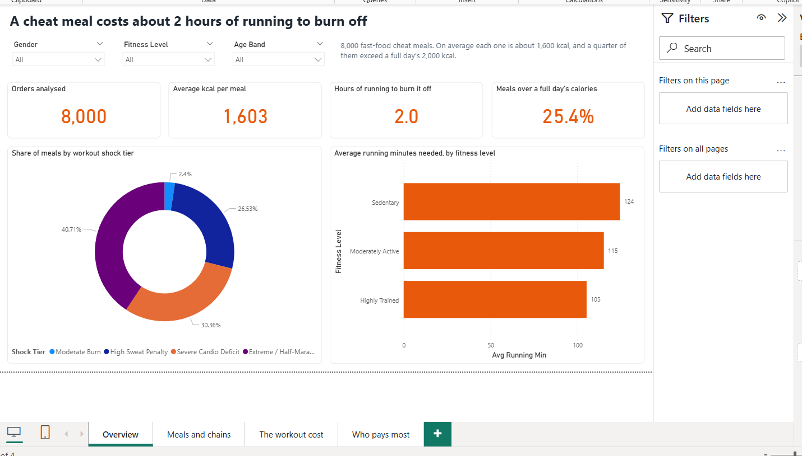
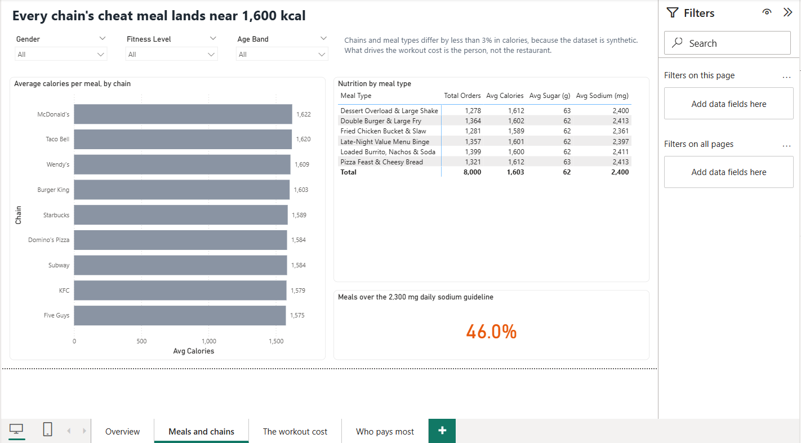
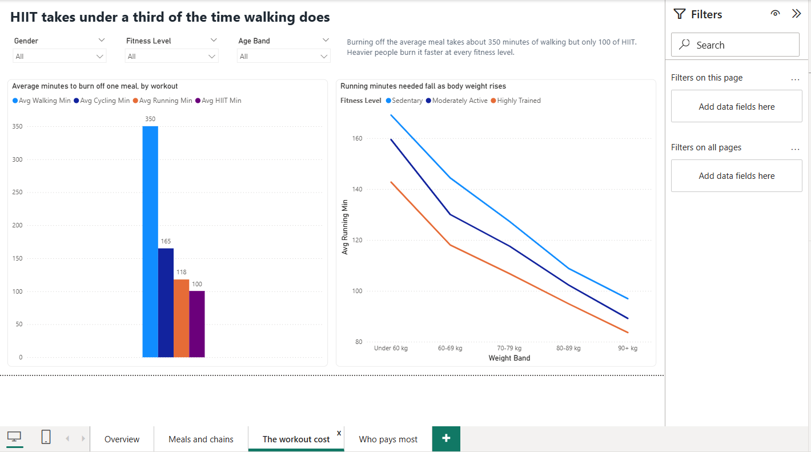
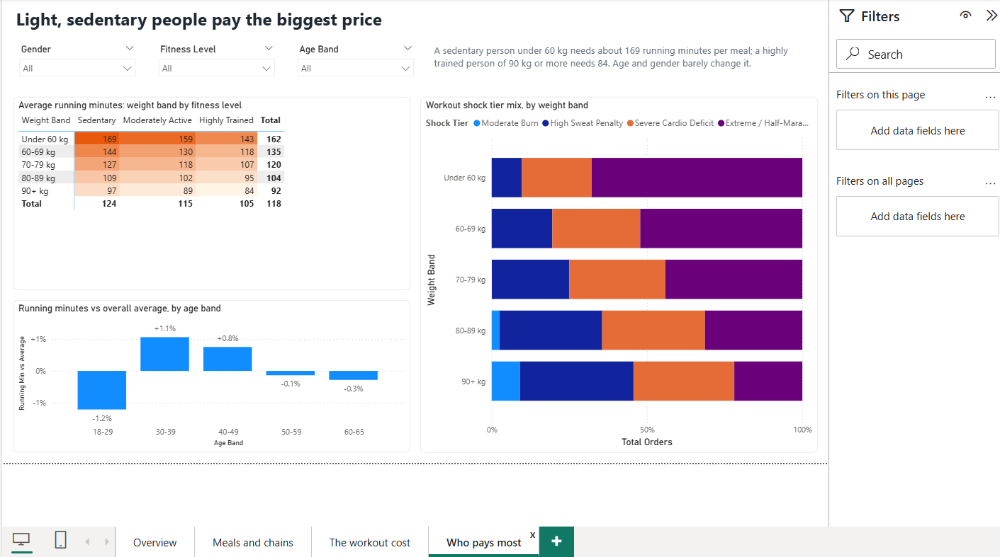

# The Workout Cost of a Cheat Meal (Power BI)

How much exercise does a fast-food cheat meal cost, and who pays the biggest price?
A 4-page Power BI report on 8,000 fast-food cheat-meal orders.

## Key findings
- An average cheat meal is about 1,600 kcal and takes about 2 hours of running (118 min) to burn off.
- 25.4% of meals exceed a full day's 2,000 kcal; 46.0% exceed the 2,300 mg daily sodium guideline.
- HIIT burns the meal off in under a third of the time walking does (100 vs 350 minutes).
- Body weight drives the cost most: a sedentary person under 60 kg needs about 169 running minutes, a highly trained person of 90 kg or more needs 84.
- 68% of meals land in the "Extreme" shock tier for people under 60 kg, vs 22% for people of 90 kg or more.
- Age and gender barely change the result (every age band within about 1% of the average).

## Data
8,000 rows, 23 columns: chain, meal type, nutrition, consumer profile, and minutes needed to burn the meal off by walking, cycling, running and HIIT.
The dataset is synthetic: every chain sells every meal type and chain averages differ by under 3%,
so the analysis focuses on body weight and fitness, which drive the workout cost.

## How it's built
- **Power Query:** a staging query (`Raw`) sets data types and adds age and weight bands; the fact and dimension tables are built from it.
- **Data model:** star schema with 1 fact table (`FactOrders`) and 7 dimensions (chain, meal type, gender, age band, fitness level, shock tier, weight band), with sort-order columns.
- **DAX:** 13 measures in display folders, including share of meals over the daily calorie and sodium limits (CALCULATE + DIVIDE) and each group's running time vs the overall average (VAR + ALL).
- **Report:** 4 pages (Overview, Meals and chains, The workout cost, Who pays most) with slicers for gender, fitness level and age band on every page.

## Files
- `CheatMealWorkout.pbix`: open this in Power BI Desktop
- `CheatMealWorkout.pbip` + `CheatMeal.Report/` + `CheatMeal.SemanticModel/`: the same report as a Power BI Project (text files, good for GitHub version control)
- `fast_food_cheat_meal_workout_burn.csv`: the source data

If you move the folder, update the CSV path in Power Query (Transform data → `Raw` → Source).
